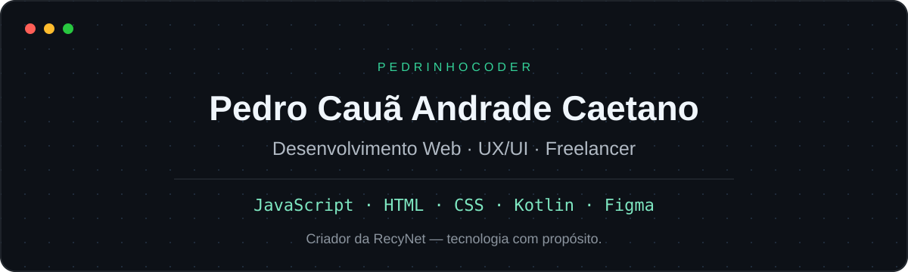

  

  <a href="#projetos-em-destaque">Projetos</a> ·
  <a href="#competências-e-ferramentas">Competências</a> ·
  <a href="#como-trabalho">Como trabalho</a> ·
  <a href="https://pedrinhocoder.github.io/RecyNet-2.0/">RecyNet online</a>

## Sobre mim

Sou **Pedro Cauã Andrade Caetano**, **desenvolvedor freelancer** e criador da **RecyNet**. Conecto desenvolvimento de software, criatividade e sustentabilidade para transformar ideias em experiências digitais.

Meu principal projeto explora como incentivar a reciclagem com registro de materiais, acompanhamento de impacto e gamificação. Também exploro o desenvolvimento de aplicativos com **Kotlin**.

## Projetos em destaque

### 01 — RecyNet

**Tecnologia para incentivar hábitos sustentáveis.**

Plataforma web com registro de materiais recicláveis, pontuação, níveis, ranking e relatórios de atividades. A proposta é tornar a participação na reciclagem mais acessível e permitir o acompanhamento do impacto de cada usuário.

**Destaques:** cálculo de pontos por material e peso, progressão por quantidade reciclada, busca de locais de coleta e simulação de recompensas.

**Tecnologias:** JavaScript · HTML · CSS · GitHub Pages

[Repositório](https://github.com/Pedrinhocoder/RecyNet-2.0) · [Demonstração online](https://pedrinhocoder.github.io/RecyNet-2.0/)

> Protótipo em desenvolvimento: dados armazenados no navegador, pontos e recompensas simulados.

### 02 — App da Emily

**Explorando experiências em aplicativos.**

Projeto de aplicativo em **Kotlin**, ampliando minha experiência para além do desenvolvimento web.

**Tecnologia:** Kotlin

[Repositório](https://github.com/Pedrinhocoder/App-da-Emily)

## Competências e ferramentas

### UX/UI e design de interfaces

  

Conhecimentos em **UX/UI**, **Figma**, prototipação, wireframes, hierarquia visual e organização de fluxos de navegação, com atenção à usabilidade e ao design responsivo.

### Desenvolvimento web

  

Interfaces, interações no navegador e implementação de funcionalidades para aplicações web.

### Aplicativos

  

Exploração do desenvolvimento de aplicativos por meio de projetos próprios.

### Código e publicação

  

Repositórios públicos, documentação dos projetos e publicação web com GitHub Pages.

## Trabalho como freelancer

Atuo como **freelancer**, unindo desenvolvimento web e design de interfaces para dar forma a sites e experiências digitais. Meu foco é entender a necessidade de cada projeto e construir soluções claras, funcionais e bem apresentadas.

[Conheça meus projetos](https://github.com/Pedrinhocoder?tab=repositories)

## Como trabalho

| Etapa | Foco |
| :--- | :--- |
| **01 · Entender** | Partir de uma necessidade e definir o que a solução deve oferecer. |
| **02 · Construir** | Dar forma à interface e conectar as funcionalidades. |
| **03 · Evoluir** | Testar os fluxos, identificar falhas e aprimorar a experiência. |

---

  <strong>Pedro Cauã Andrade Caetano</strong> 
  Desenvolvedor freelancer · UX/UI · Criador da RecyNet  
  <a href="https://pedrinhocoder.github.io/RecyNet-2.0/">Conheça a RecyNet</a> ·
  <a href="https://github.com/Pedrinhocoder?tab=repositories">Explore meus projetos</a>

